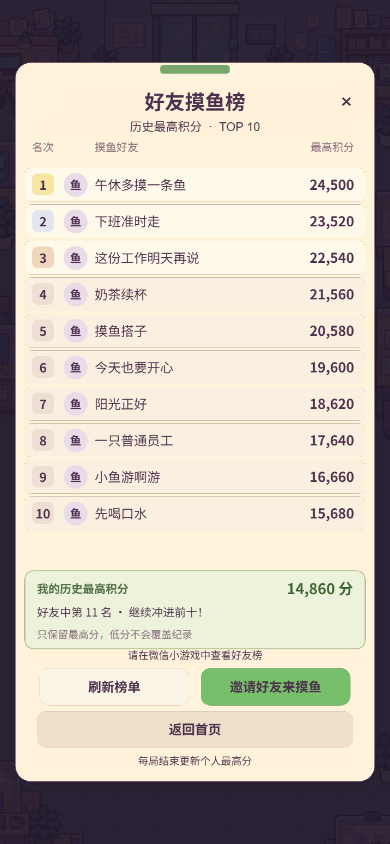
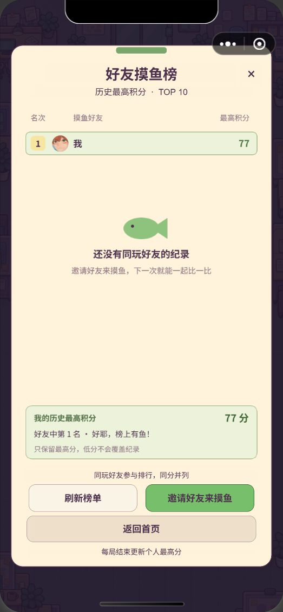
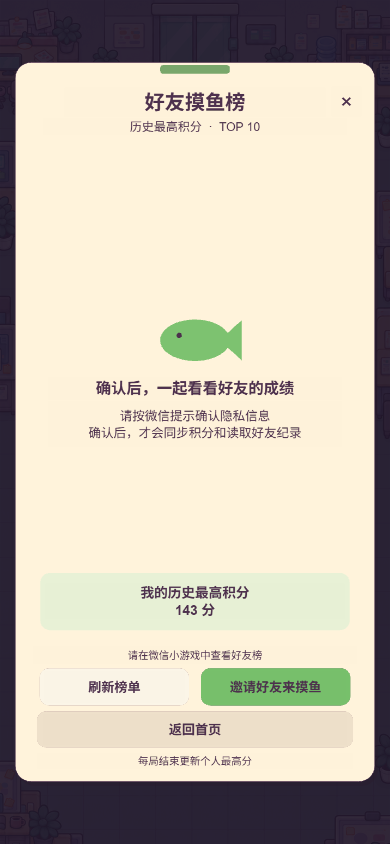
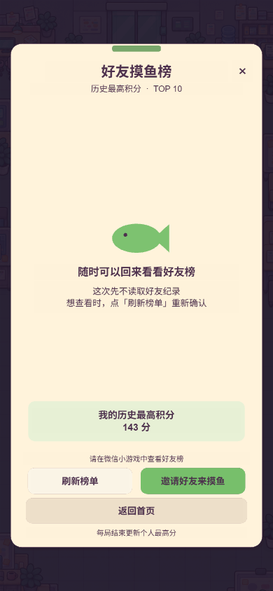

# 好友积分排行榜

## 功能与界面

首页和摸鱼成绩单上方新增「好友积分榜」纸张按钮，保留开始游戏、再来一局、音效和操作教学的原有入口。榜单为居中纸卡，采用奶油底色、莓紫文字、绿色按钮，背景加深以突出榜单。

- 标题：好友摸鱼榜；副标题：历史最高积分 · TOP 10。
- 榜单：名次、圆形头像、昵称、最高积分。前三行有金、银、铜色名次标记，自己的行使用绿色背景。长昵称截断，积分加千位分隔。
- 排序：每个玩家只保留正式对局的最高积分，按积分降序；同分并列。相同分数的显示顺序按达到时间、内部标识稳定排序。
- 固定底栏：我的历史最高积分、好友中的排名。未进前十仍能看到自己的排名；新纪录未同步时说明排名等待更新。
- 操作：「刷新榜单」「邀请好友来摸鱼」「返回首页／返回成绩单」，右上角也可关闭。
- 说明：同玩好友参与排行，同分并列；每局结束更新个人最高分。

所有十行在常见竖屏尺寸中同时可见，无需滑动。榜单按可见屏幕高度整体缩放；打开期间拦截游戏操作、空格键，Esc 可关闭。

## 状态文案

| 状态 | 呈现 |
| --- | --- |
| 加载中 | 正在寻找摸鱼搭子…／好友纪录马上就到 |
| 未完成首局 | 好友榜的第一条小鱼，等你来摸／先完成一局，再邀请好友一起比一比 |
| 只有自己 | 显示自己的纪录，提示「还没有同玩好友的纪录」 |
| 网络失败 | 暂时没连上好友榜／检查网络后，点下方「刷新榜单」再试试 |
| 分数上传失败 | 底栏提示同步失败及本地成绩已保存，刷新可重试 |
| 浏览器预览 | 好友都在微信里等你／请在微信小游戏中查看好友积分榜，同时显示本地最高分 |
| 等待隐私确认 | 确认后，一起看看好友的成绩／请按微信提示确认隐私信息，确认后才会同步积分和读取好友纪录 |
| 未确认隐私 | 随时可以回来看看好友榜／这次先不读取好友纪录，点「刷新榜单」可重新确认 |
| 缺失头像 | 使用圆形「鱼」或「我」标记，头像下载失败不阻塞榜单 |

分享按钮只打开微信分享面板，不把打开面板视为分享成功，不发放分享奖励。

## 微信实现

采用微信托管数据与开放数据域，未引入业务服务器、云开发数据库、广告或账号登录页面。

首次未确认隐私时，启动游戏只保存本地积分；点击好友榜后通过微信的隐私确认流程继续。已确认的玩家启动和结算时自动同步。退出等待中的榜单不会被后续回调重新打开，暂不确认也可以继续游戏。接口依据：[微信隐私确认接口](https://developers.weixin.qq.com/minigame/dev/api/open-api/privacy/wx.requirePrivacyAuthorize.html)。

- `PlatformServices.ts`：主域平台服务，只发送榜单操作和玩家自己的最高分，调用微信分享能力。
- `GameInterface.ts`：纸卡 UI、入口和 `SubContextView`；好友数据不进入主域。
- `GameMain.ts`：启动和正式对局结算时同步最高积分；处理打开、刷新、分享和关闭。
- `build-templates/wechatgame/openDataContext/`：好友查询、云端纪录读写、排序及 Canvas 绘制。此目录进入版本控制。
- `scripts/package-friends.mjs`：构建成功后复制开放数据域，并向生成的 `game.json` 添加 `openDataContext`，回读验证。

微信托管 key 为 `offwork_best_v1`。纪录包含版本、最高分、达到时间及随机纪录标记。随机标记只用于开放数据域内识别自己的榜单行，不读取用户资料，不回传好友 OpenID、头像、昵称或分数给主域。

上传前先读取云端纪录，避免低分或新设备的空存档覆盖已有最高分。读取失败时不写入；连续成绩上传在当前运行实例中串行处理，刷新时可重试。网络请求设置 8 秒超时，过期刷新和关闭后的回调不重新显示榜单。

托管数据写入没有跨设备事务，两个设备同时提交成绩存在最后写入覆盖的限制；此版也未实现服务器校验积分，适用于当前无奖励的休闲好友榜。

## 验证与使用

常规命令：`npm test`、`npm run test:soak`、`npm run build:web`、`npm run build:wechat`、`npm run qa`。

排行榜专项：

```powershell
$env:GAME_PORT='18463'
$env:CDP_PORT='18466'
node scripts/qa-friends.mjs
npm run qa:wechat -- --friends
```

浏览器专项需先启动 `scripts/serve-build.mjs` 和带调试端口的 Chrome。微信专项需微信开发者工具登录、打开本项目构建并完成编译。两个脚本均操作真实运行的 Cocos 界面；浏览器 UI 预览使用明确的测试数据，并非真实好友。

全流程浏览器回归建议使用独立 Chrome 会话，避免其他专项改变触屏模拟状态。微信隐私提示由使用者本人确认，自动化脚本不代替用户点击确认。

2026-10-14 最终验证结果：

- `npm test`：102 项通过；`npm run test:soak`：3 项通过。
- `npm run qa`：独立 Chrome 会话的 138 项通过。
- 好友榜浏览器专项：16 项通过，覆盖三种竖屏尺寸、前十名、个人第 11 名、空榜、请求失败、同步失败和隐私状态。
- 微信开发者工具专项：8 项通过；使用者手动确认隐私后，真实开放数据域显示自己的云端最高分及暂无同玩好友提示，控制台无运行错误。
- Web、微信 release 构建均有 `build Task (<platform>) Finished` 标记，必要产物存在，微信开放数据域目录及清单回读验证通过。

自动化报告保存在 `employee-off-work/temp/qa/`，不提交生成的构建目录和临时测试目录。手机上多人好友关系、跨设备同一微信账号，以及网络切换下的托管成绩，仍需使用两个有体验权限的微信账号人工复验。

## UI 预览

以下预览使用测试样例，展示真实 Canvas 排行榜渲染器与 Cocos 纸卡 UI：



微信开发者工具实际画面（当前仅有个人纪录）：



隐私确认状态预览：




