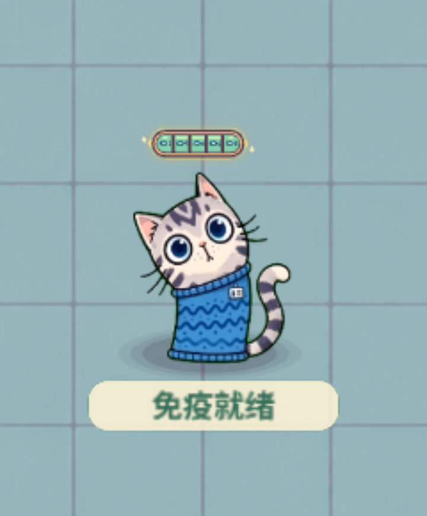
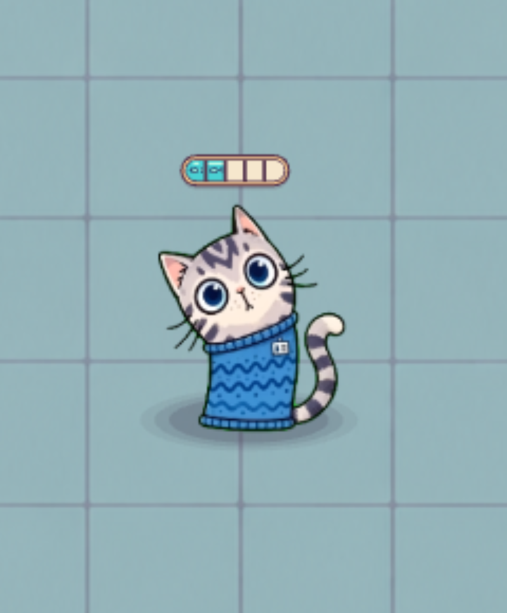

# 头顶五格小鱼能量条

按 2026-10-13 确认的第二版方案实现。原有无敌特效保持现状，本次只修改小鱼蓄能显示、满格提醒和拾取光点的目的地。

## 显示与反馈

- 能量条位于猫耳上方，跟随实际角色位置、受击震动与教学跳动，保持同一帧同步。
- 整体是一个五格胶囊，宽度按可见身体计算，不使用含透明边距和尾巴的角色图集尺寸。
- 采用现有得分、工作负荷 UI 的深紫褐描边、暖橙奶油外沿和奶油空格；内部四条分隔线加粗。
- 每条小鱼增加 20 能量，从左向右点亮一格；点亮格采用小鱼的青蓝薄荷色，带小鱼线描装饰。
- 拾取光点沿短弧线飞向角色头顶对应格，抵达后该格的小鱼图案轻弹并闪亮。
- 满五格时，整个胶囊每 1.1 秒循环泛起金光，包含整体淡金覆盖层、外圈光晕和两侧小星光；格子及小鱼仍保持清楚。
- 暂停时冻结能量条动画；消耗能量后回到空格并关闭金光；重新开始和回到首页清除就绪状态。

## 尺寸与绘制

720 宽设计坐标下，胶囊宽 48、高 14，距离最高猫耳 6。中心对齐身体横向偏移 -8。为顶部能量条预留空间，胶囊顶部与 HUD 底部保持 10 的间距；相对上一版，角色顶部边界下移 20，1:1 拖动方式不变。

手机尺寸下，Cocos Graphics 的细描边抗锯齿会削弱图案和分格线。外框、分隔线和小鱼线描采用实心几何轮廓及内嵌填充，保持小尺寸下的对比度；不添加新图片、场景或 Prefab。

## 无敌行为

双击、空格键、头像点击入口保留；无敌仍为 3 秒。猫猫原有薄荷重影、移动残影、星光、碰撞反馈、脚下文字及头像剩余时间环保留。头顶胶囊只显示小鱼能量，无敌期间不切换为新的倒计时设计。

## 实现文件

- `employee-off-work/assets/scripts/FinalArtHud.ts`：胶囊绘制、五格状态、金光循环、头顶定位、拾取目标点。
- `employee-off-work/assets/scripts/GameMain.ts`：拾取光点轨迹与角色实际绘制位置同步。
- `employee-off-work/assets/scripts/model/GameLayout.ts`：胶囊尺寸和顶部安全间距。
- `employee-off-work/tests/layout-and-pause.test.mjs`：不同屏幕比例下顶部间距验证。
- `employee-off-work/scripts/qa-energy-fixture.mjs`：真实运行时的拾取、跟随、金光、暂停、无敌兼容回归。
- `employee-off-work/scripts/qa-playthrough.mjs`、`qa-wechat.mjs`：网页与微信回归；网页 `--energy` 可单独输出三种状态的高像素密度截图。

## 已完成检查

- `npm test`：70/70 通过。
- `npm run test:soak`：3/3 通过。
- `npm run qa`：104/104 通过，无浏览器运行时错误。
- `npm run qa -- --energy`：8/8 通过，空格、部分点亮、满格截图已放大检查。
- `npm run qa:wechat`：69/69 通过，微信开发者工具实际运行回归无错误，最终截图已检查。
- `npm run build:web`：`build Task (web-mobile) Finished` 为 true，3 个必需产物存在。
- `npm run build:wechat -- appid=wxcefa299717fbb2da`：`build Task (wechatgame) Finished` 为 true，4 个必需产物存在，微信适配启动检查通过。

## 效果截图

完整网页运行画面：`screenshots/energy-capsule-web.png`。

微信开发者工具运行画面：`screenshots/energy-capsule-wechat.png`。

## 微信试玩

官方预览二维码已生成成功：`screenshots/energy-capsule-preview-qrcode.jpg`。当前预览包 20,903,607 字节，主包 3,046,237 字节，美术分包 17,857,370 字节。

